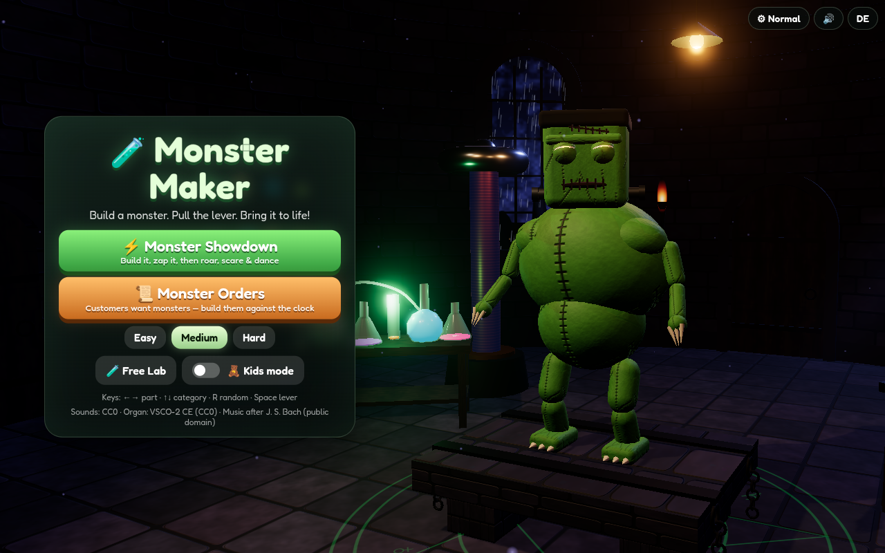
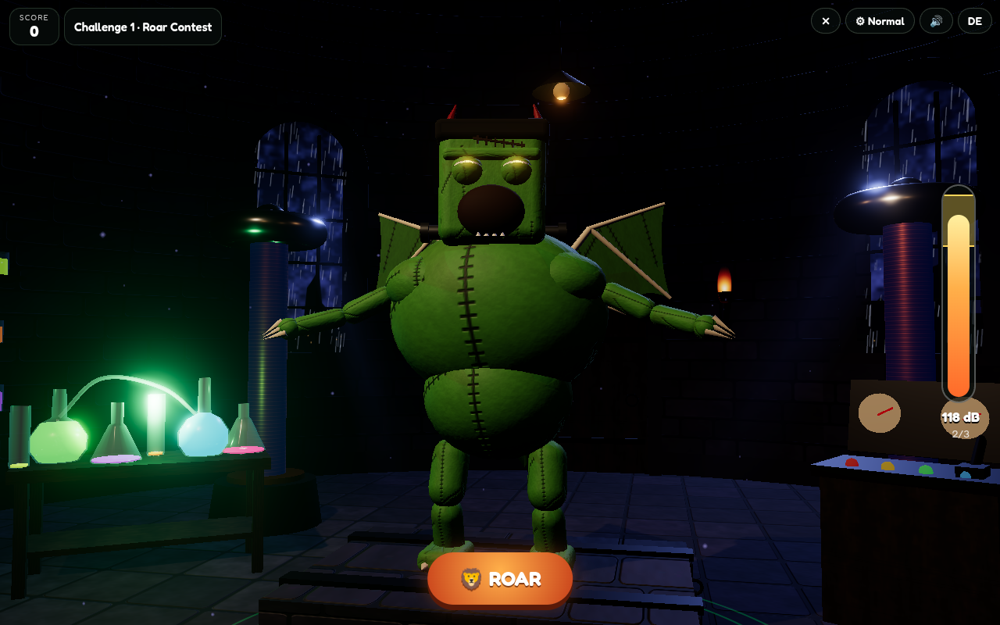
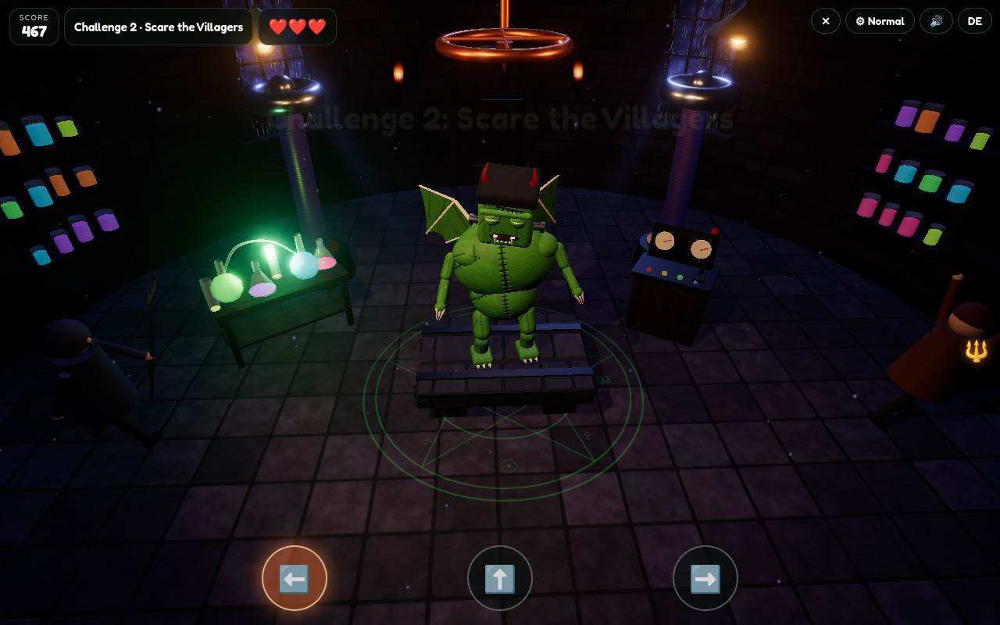
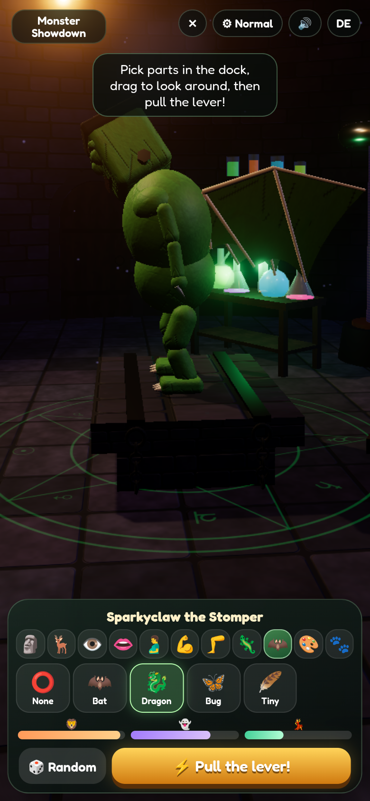

# 🧪 Monster Maker

A cinematic 3D Halloween game. Midnight in a mad-scientist lab at the top of a gothic tower: Tesla coils hum, flasks bubble, rain lashes the windows and lightning flickers across the storm sky. On the stone slab lies your creation. Build it from mix-and-match 3D parts, pull the big lever and bring it to life. Then let it compete in the **Monster Showdown** or fill **Monster Orders** for the villagers against the clock.

**Play:** https://frank-otto.github.io/monster-maker/

## How to play
- **Build:** 11 part categories: head, horns, eyes, mouth, body, arms, legs, tail, wings, colour and pattern. That gives 6 heads (bolt-neck, round, pumpkin, dragon, alien, bat), spider and tentacle legs, bat, dragon and bug wings, scorpion tails, 8 colours, glowing patterns, and more than 60 parts in total. Every part changes your monster's **Roar / Scare / Groove** stats, and every monster gets a name ("Voltclaw the Stomper"). Drag to look around. The camera focuses on the part you are editing. 🎲 Random rolls a whole new monster.
- **⚡ Pull the lever:** the coils charge while the pipe organ plays the opening of Bach's Toccata in D minor. Arcs crawl over the body, the lamps flicker and the heart starts beating. Then lightning strikes the rod, sparks fly and thunder rolls. The eyes light up and *IT'S ALIVE!* The monster roars and moves with procedural animation: breathing, blinking, looking around, leg IK and swaying tentacles, tails and wings.
- **Monster Showdown:** three challenges, scored with your stats.
  1. **Roar Contest:** hold Space (or the ROAR button) to fill the lungs and let go in the gold zone. A great roar shatters the jars on the shelves. Hold too long and the roar fizzles.
  2. **Scare the Villagers:** villagers with torches and pitchforks sneak in through three doors. Press ← ↑ → (or tap the door pads) when they come close. The closer they are, the more points you get. Each villager who reaches you pokes you and costs a heart. Lose all hearts and the mob chases you off.
  3. **Dance-off:** the monster shows a sequence of moves on the beat, then you copy it with the arrow keys or pads (Perfect / Good / Miss).
- **Monster Orders:** the Mayor, the Swamp Witch, the Count, a lonely Ghost, the Baker, the Pirate Captain and the Gardener each walk in with a wish, for example "a pet for my cauldron: red, with wings and a scorpion tail". Rebuild the monster before the timer runs out, then zap and deliver it. You earn 0 to 3 stars plus a time bonus. Botch too many orders and the shop closes.
- **Free Lab:** no rules. Zap the monster again, swap parts while it lives, and make it roar and dance.

Difficulty **Easy / Medium / Hard** sets the gold zone, the number of villagers and hearts, the dance timing, the number of order wishes and the time limit. A highscore is kept per mode and difficulty. **Kids mode** can never fail: the roar cannot overcharge, villagers only tickle, wishes are simple with no timer, and the grade is always at least B.

Extras:
- English by default, with a **DE** toggle that is remembered.
- A shareable **monster card** (PNG, 1080×1350, default name "Player").
- **Quality levels** (Low / Normal / High / Ultra) with a careful auto step-down.
- Phone portrait layout with touch controls.

## Tech
Three.js (WebGL) with:
- a round stone tower room with normal-mapped walls and flagstones, an alchemical floor circle, beams and an open roof hatch;
- gothic windows with storm clouds, rain and bolts, and three doors with hinged leaves and wall torches;
- two Tesla coils with live Line2 arcs, a lever console, a flask bench with bubbles, shelves of glowing jars and swinging lamps;
- PCF shadows, ACES tone mapping and a restrained bloom (no glare).

Monsters are built procedurally from parts, with two-bone IK legs, spider legs and tentacle chains. The camera is pushed out of every prop and never leaves the room. Effect values are NaN-guarded, and the frame clock never runs backwards. Audio is sample-accurate WebAudio scheduling with a generated tower reverb. Everything is bundled with esbuild into one classic script, so the game runs straight from `file://`.

## Run locally
Open `index.html` (on a Mac you can also double-click `start.command`). Rebuild after editing `src/`: `npm install && npm run build`.

## Tests
`python3 test/test_game.py` (Playwright + Chrome, headless WebGL, served over a local web server) covers:
- every part option, stats and names, keyboard and touch input;
- the lever cinematic, all three challenges, orders, Free Lab, difficulties and Kids mode;
- highscores, the PNG card and EN/DE memory;
- frame clock, NaN, black-frame, glare and camera-clipping checks, auto quality and the phone layout;
- no console errors and no synth sounds.

## Credits
All sounds are recorded CC0 samples: pipe organ and instruments from the VSCO 2 Community Edition, effects from Freesound and Kenney (IDs in `LICENSES/SOUNDS.md`). Music after J. S. Bach (public domain). Three.js (MIT). Font: Fredoka (SIL Open Font License 1.1).

